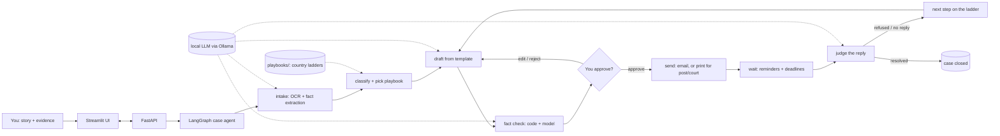

# Escalate

**The AI agent that fights for your refund, so you don't give up.**

Escalate takes your complaint and your evidence (a refund refused, a subscription that won't
cancel, a scam) and runs it up the ladder: a written demand, a final notice, the consumer
authority, then consumer court. It drafts every letter, tracks deadlines and follows up when the
company goes quiet. **You approve every message before it is sent.** It runs on your own
computer, with a free local AI model.

<!-- Demo GIF: record it and save as docs/demo.gif, then uncomment the next line.

-->
> 🎬 Demo GIF coming soon (`docs/demo.gif`).

> ⚖️ Escalate is a self-help tool, **not legal advice**. Check the rules in your country.

## Why it exists

A family member bought an LED TV that broke within days. They returned it, and for eight months
the shop answered every message with "we'll replace it when the company approves the claim".
Most people give up at that point: they don't know the next step, the deadlines, or how to write
a legal notice. Escalate knows the ladder, writes the letters, and keeps the pressure on until
the case is resolved or ready for court.

## Quick start

You need [Docker](https://docs.docker.com/get-docker/) and about 8–16 GB of RAM for the local model.

```bash
git clone https://github.com/zainismail-dev/escalate.git && cd escalate
make setup     # creates .env (with an encryption key), builds images, pulls a local model
make up        # then open http://localhost:8501
```

`make setup` pulls `llama3.1:8b` by default (`make setup MODEL=<name>` for another). No model has
been evaluated as "recommended" yet: see [evals/report.md](evals/report.md).

Without `make`: `cp .env.example .env`, set `FERNET_KEY` and `MODEL_SMART`, then
`docker compose up`.

<details>
<summary>Run without Docker (for development)</summary>

```bash
uv sync
cp .env.example .env        # set FERNET_KEY, MODEL_SMART, MODEL_FAST
uv run uvicorn escalate.api.main:app --reload
uv run streamlit run ui/app.py
```

You also need Tesseract (OCR) and Pango (PDF export) installed on your system.
</details>

## How it works



- **Playbooks** (`playbooks/<country>/…yaml`) describe each ladder: steps, wait times, deadlines
  and official sources. The resolver picks the most specific one: company → region → country →
  a generic international ladder that works anywhere.
- **Templates** (`templates/<country>/<language>/`) hold the letters. The model only polishes
  tone and language; the structure and every fact come from the template and your case.
- **One process** runs the API and the scheduler (reminders survive restarts); the UI only talks
  to the API, so a future mobile or chat front end can reuse it.
- **Free by default:** a local model through Ollama; any OpenAI-compatible endpoint works
  (Groq, Gemini, OpenRouter, paid APIs) by changing one line in `.env`.

## Safety

- **Human approval on every message.** Nothing is sent until you click approve. This is
  enforced in code and tested on every send path. The AI has no ability to send.
- **Facts only.** Every amount, date and ID in a draft must come from your case facts; drafts
  that invent anything are sent back. Your own edits are checked too.
- **Polite and firm.** Threats and insults are blocked before approval.
- **Private.** Evidence is encrypted at rest; card numbers, IBANs, national ID numbers and any
  password or one-time code you type are masked in logs, stored text and drafts. Escalate never
  asks for passwords, PINs or OTPs. You get a warning when your AI model runs in the cloud.
- **Not legal advice.** Letters and PDF case files say so. See [SECURITY.md](SECURITY.md).

## Supported countries

| Country | Refund refused | Subscription | Scam checklist | Status |
| --- | --- | --- | --- | --- |
| 🌍 Any country | generic ladder | generic ladder | generic | ✅ always available |
| 🇵🇰 Pakistan | seller → marketplace → 15-day legal notice → District Consumer Court (en, ur) | generic | ✅ | needs lawyer review |
| 🇮🇳 India | demand → legal notice → District Consumer Commission | generic | ✅ | starter, needs verification |
| 🇬🇧 United Kingdom | complaint → letter before action → small claim | generic | ✅ | starter, needs verification |
| 🇺🇸 United States | demand → final demand → state attorney general → small claims | generic | ✅ | starter, needs verification |

**Add your country:** see [docs/CONTRIBUTING-PLAYBOOKS.md](docs/CONTRIBUTING-PLAYBOOKS.md). Every
rule must cite an official source.

## Roadmap

- **v0.1** (now): 3 case types, generic + 4 country packs, email/post/court channels, PDF case file.
- **v0.2:** Telegram bot, more UI translations, detect replies in your inbox.
- **v0.3:** more countries from the community, scam packs per bank.
- **v1.0:** Next.js app, multi-user hosting, opt-in anonymous success rates per playbook.

## Contributing

Contributions are welcome, especially country playbooks, translations and template reviews by
lawyers or consumer-rights groups. Start with [CONTRIBUTING.md](CONTRIBUTING.md) and the
[good first issues](docs/good-first-issues.md). Please follow the
[Code of Conduct](CODE_OF_CONDUCT.md).

```bash
make test    # offline unit and integration tests (fake LLM, fake email)
make lint    # ruff, mypy and the playbook validator
make evals   # golden-set evals against your model
```

## License

[MIT](LICENSE).

## Acknowledgements

Built with LangGraph, FastAPI, Streamlit, SQLAlchemy, APScheduler, Tesseract, WeasyPrint,
Babel and Ollama. Pakistan's consumer-court route follows the CRCP guide cited in its playbook.
